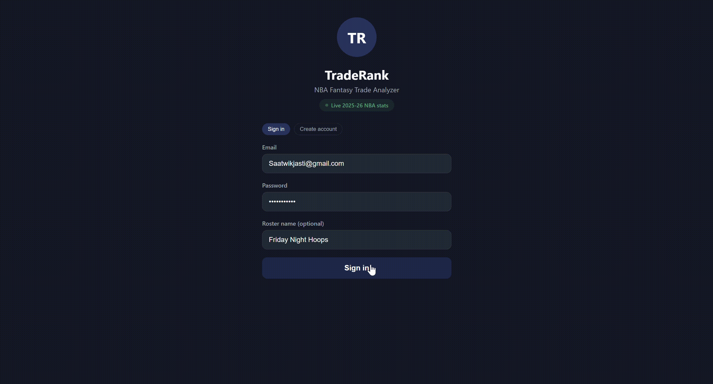

# TradeBall

<p align="center">
  <strong>Full-stack NBA fantasy basketball trade analysis powered by live player data and transparent 9-category valuation.</strong>
</p>

<p align="center">
  
  
  
  
  
  
  
  
</p>

---

## Demo

<p align="center">
  
</p>

> **TradeRank** is the user-facing application name; **TradeBall** is the repository and backend project name.

---

## Overview

TradeBall is a full-stack fantasy basketball platform built to answer a simple question:

**Is this trade actually good for my team?**

The application lets fantasy managers authenticate, manage their roster, search NBA players, build trades, and receive an explainable evaluation based on player performance across the standard nine-category fantasy basketball format.

The project evolved from a locally hosted fantasy trade evaluator into a production-oriented client/server application. The frontend is responsible for the user experience and API integration, while the Spring Boot backend is the authoritative source for authentication, roster ownership, player data, fantasy valuation, trade scoring, and trade history.

---

## Features

### Fantasy & Trade Analysis

- Live NBA player and statistical data
- Player search and player detail views
- Fantasy value calculations
- 9-category trade evaluation
- Category-by-category gains and losses
- Overall trade fairness / value score
- Human-readable trade recommendations
- Trade history
- Roster-aware trade evaluation

### Accounts & Rosters

- User registration and login
- JWT-based authentication
- BCrypt password hashing
- Authenticated roster management
- Server-side ownership and authorization checks

### Backend & Infrastructure

- RESTful Spring Boot API
- PostgreSQL persistence
- Flyway database migrations
- Redis caching with Caffeine fallback
- NBA data synchronization endpoints
- OpenAPI / Swagger documentation
- Spring Boot Actuator health endpoints
- Docker-based development and deployment
- Automated testing with JUnit, Mockito, H2, and Testcontainers
- GitHub Actions CI

### Client

- Responsive HTML/CSS/JavaScript frontend
- API-driven UI with no duplicated trade-scoring logic
- Capacitor Android project for mobile packaging
- Production frontend/backend separation

---

## How TradeBall Evaluates a Trade

TradeBall uses a **Z-score-based fantasy valuation model** across nine standard categories:

| Category | Type |
|---|---|
| Points | Higher is better |
| Rebounds | Higher is better |
| Assists | Higher is better |
| Steals | Higher is better |
| Blocks | Higher is better |
| Three-Pointers | Higher is better |
| Field Goal % | Higher is better |
| Free Throw % | Higher is better |
| Turnovers | Lower is better |

The evaluation pipeline is handled by the backend:

```text
NBA Player Data
      ↓
Player Statistics
      ↓
9-Category Fantasy Valuation
      ↓
Incoming vs. Outgoing Players
      ↓
Category-Level Comparison
      ↓
Overall Trade Score
      ↓
Recommendation + Explanation