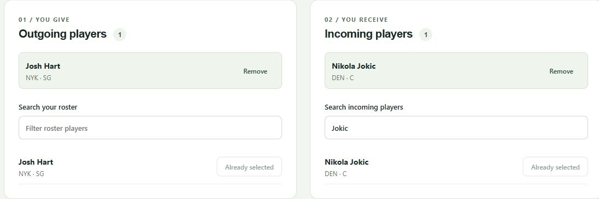
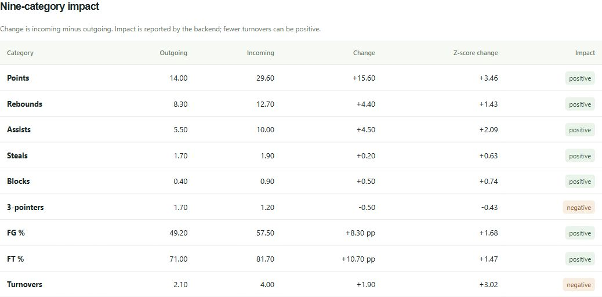

# TradeBall

TradeBall helps fantasy basketball managers compare outgoing and incoming players
across nine categories. The Spring Boot backend owns player valuation, trade
scoring, authentication, roster ownership, and saved trade history. **TradeRank**
is the name shown in the client.

The original JavaScript/Capacitor application remains in `www/`. A focused
React + TypeScript comparison workflow builds alongside it into `www/compare/`.
The October backend and React improvements have been **verified locally**; their
remote CI execution and publication alongside an existing deployment are not
verified. No new deployment or league adoption is claimed.

## What the comparison workflow does

- Sign in through the existing JWT API client, restore a session, and handle expiry.
- Select a roster; create one and add players if the account is empty.
- Search owned players for the outgoing side and backend player data for incoming.
- Add/remove selections and prevent duplicate or cross-side player IDs.
- Submit a roster-scoped trade; display the backend's actual score, explanation,
  side valuations, and category deltas. The browser does not calculate substitute scores.
- Show loading, empty, validation, network/API error, and expired-session states.

The server independently enforces validation and resource ownership. Client-side
checks improve usability; they are not authorization controls. Raw turnover
deltas and the backend's reported impact are displayed separately because fewer
turnovers can be better.

## Screenshots

These screenshots show local development-snapshot data and real backend results.
Account names, roster names, credentials, and trade identifiers are outside the
captured regions. Historical full-page screenshots remain private local evidence.




## Stack and structure

| Area | Technologies |
|---|---|
| Comparison UI | React, TypeScript, Vite, CSS |
| Original client | HTML/CSS/JavaScript; Capacitor Android project |
| Backend | Java 21, Spring Boot 3.3, REST, Spring Data JPA |
| Security | Spring Security, JWT, BCrypt, server-side ownership checks |
| Data | PostgreSQL, Flyway; configurable Redis or Caffeine caching |
| Tests | JUnit, Mockito, H2, Testcontainers; Vitest, React Testing Library |
| Build and CI | Maven, npm, Docker/Compose, GitHub Actions CI |

```text
frontend/                 React components, types, tests, and Vite config
www/index.html            Original app entry point
www/js/                   Existing client and shared API client
www/compare/              Generated React build; ignored by Git
backend/src/              Spring Boot application and tests
backend/docs/             Benchmark protocol and observed results
backend/scripts/          Reproducible benchmark summarizer
.github/workflows/        Backend and frontend CI definitions
```

Both clients use versioned `/api/v1` endpoints. Trade evaluation accepts incoming
IDs, outgoing IDs, and roster scope. Player/stat loading uses batch reads and
reconstructs request order. The weighted Z-score valuation engine covers points,
rebounds, assists, steals, blocks, three-pointers, field-goal percentage,
free-throw percentage, and turnovers. Population reads and history writes remain
part of evaluation; query reduction does not make the whole request constant-cost.

## Local setup

Verified prerequisites: Java 21, Maven, Node 24/npm, Docker Desktop's Linux engine,
and Python for serving the static build. The following uses an isolated local
PostgreSQL database on 15432 and API on 18080, avoiding an existing service on 5432.

From the repository root:

```powershell
npm ci
docker compose -p tradeball-react-local -f frontend/compose.local.yml up -d
```

In a second terminal, start the backend:

```powershell
cd backend
$env:SPRING_PROFILES_ACTIVE = 'dev'
$env:DATABASE_URL = 'jdbc:postgresql://localhost:15432/tradeball_react'
$env:DATABASE_USERNAME = 'tradeball'
$env:DATABASE_PASSWORD = 'tradeball'
$env:SERVER_PORT = '18080'
$env:CORS_ALLOWED_ORIGINS = 'http://localhost:5500,http://127.0.0.1:5500,http://localhost:5173,http://127.0.0.1:5173,http://localhost,capacitor://localhost'
$env:NBA_API_BASE_URL = 'http://127.0.0.1:9'
$env:NBA_API_MAX_RETRIES = '0'
$env:NBA_API_CONNECT_TIMEOUT_MS = '500'
$env:NBA_API_READ_TIMEOUT_MS = '500'
$env:JWT_EXPIRATION_MS = '86400000'
mvn --batch-mode spring-boot:run
```

Wait for the development seed sync to finish. This intentionally uses the existing
curated fallback after a fast local upstream connection failure: **40 players and
season-2026 stats, not live NBA data**. Scoring and persistence still run through
the actual backend and PostgreSQL. The development profile's seeded account is
`demo@tradeball.local` / `Demo1234!`. These are public local-only fixture credentials.
Never enable development seeding or reuse these credentials in a shared deployment.

In another terminal at the repository root:

```powershell
npm run dev
```

Open [the development comparison](http://127.0.0.1:5173/). Vite proxies `/api` to
18080. The CORS origins above are required because the proxy forwards Origin.

To check the production bundle locally:

```powershell
npm run build
python -m http.server 5500 --bind 127.0.0.1 --directory www
```

Open [the built comparison](http://localhost:5500/compare/index.html) or
[the original app](http://localhost:5500/index.html). The new comparison defaults
to the local API on 18080. The original app keeps its existing API-base setting;
its entire workflow was not reverified against this isolated database.

For a different comparison backend, set `VITE_API_BASE` to the public API URL
including `/api/v1` **before building**. This value is public and must not contain
secrets. The legacy page's runtime base is configured separately. Do not publish
the localhost default. See [the frontend guide](frontend/README.md) for component,
state, API, Windows test-temp, and Capacitor details; see [the backend guide](backend/README.md)
for its separate Docker development setup and production environment variables.

## Testing and CI status

From the repository root:

```powershell
npm run typecheck
npm run test:frontend
npm run build
cd backend
mvn --batch-mode verify
```

Latest completed local verification:

| Check | Result |
|---|---|
| Frontend | 10 focused tests passed; strict TypeScript check and production build passed |
| Surefire | 31 tests passed, no skips |
| Failsafe | 4 PostgreSQL correctness tests passed; 1 opt-in benchmark method skipped |
| Browser | Development and production bundles against local PostgreSQL; actual trade/history, validation, network failure, and real JWT expiry |

Skipped PostgreSQL tests must never be counted as passes when Docker is unavailable.
The benchmark was run separately for the completed performance experiment; it is
not required on ordinary verification runs. No benchmark was rerun during publication preparation.

GitHub Actions definitions exist for backend Maven verification and frontend
`npm ci`, tests, and build/typecheck. The new jobs have not been verified on GitHub
for these unpushed changes. This is **CI**, not verified CI/CD or deployment automation.

## Measured local performance

The completed experiment used **local in-process authenticated API requests**
through MockMvc to PostgreSQL, **concurrency 1**, **500 synthetic players and 1,000
stat rows** (500 current-season and 500 off-season), and two fixture users.
Each implementation had 600 measured requests: 200 each for 1-, 3-, and 10-player
sides. Each scenario/round had 30 warmups; setup and history cleanup were outside
timed requests. Application/L2 caches were disabled; database buffers were warm.
Socket/network latency was excluded.

| Trade size | SQL statements per request, before to after | Median latency, before to after |
|---|---:|---:|
| 1-for-1 | 20 to 20 | 102 to 103 ms |
| 3-for-3 | 32 to 24 | 130 to 108 ms |
| 10-for-10 | **74 to 38** | **234 to 144 ms** |

All 1,200 measured requests succeeded and valuation snapshots matched except for
generated IDs. **1-for-1 did not improve.** Smaller-trade tail latency was mixed;
the 3-for-3 second-round p95/p99 regressed despite a lower median. These are
synthetic local results, not production traffic, throughput, or scale claims.
See [the protocol and per-round distributions](backend/docs/trade-performance.md)
and [the standard-library summarizer](backend/scripts/summarize_trade_benchmark.py).

## Publication and remaining verification

The repository contains a backend Dockerfile, not a manifest proving current
cloud settings. Its image does not build or serve `www/`. The shared legacy
client defaults to the owner-confirmed backend at
`https://tradeball-backend.onrender.com` (`/api/v1` for application requests).
A read-only health GET on October 17 initially timed out. On October 18 the owner
restored paused Supabase and verified health returned `UP` with liveness/readiness
groups. This verifies existing backend health, not deployment of the new local
changes. The backend remains on its confirmed **Free** plan. Frontend hosting,
workspace billing limits, and the live commit remain unconfirmed.
The backend watches `main` with **On Commit** auto-deploy and root
`backend`; pushing backend changes to `main` can deploy automatically. Prepared
changes remain on local branch `feature/tradeball-publication-review`.
The new React workflow is not claimed to be live.

A frontend host must install/build from the repository root and publish **`www`**
to preserve both `/index.html` and `/compare/index.html`, with the confirmed
HTTPS API base and matching backend CORS origin. A later release must verify
both clients' API bases, real deployed authentication/trades, and asset paths.
No database or Redis migration is needed for this frontend build.

Current npm audit findings are separately documented in
[publication review](docs/publication-review.md): four inherited Capacitor/CLI
findings, with none reported for the added frontend dependency tree. Native
device validation and remediation of the inherited mobile findings remain open.
No license file is currently supplied; the previous unsupported MIT badge/claim
has been removed.
